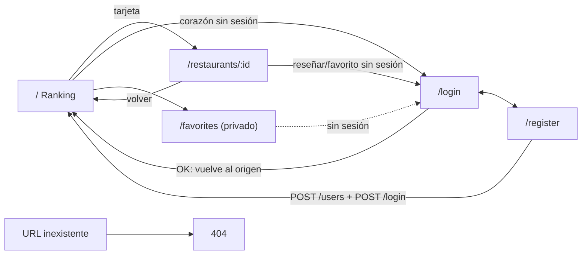

# Checkpoint TP2 – Ranking de Restaurantes (Front-end)

- **Proyecto:** SPA pública para el ranking de restaurantes (la administración queda en Rails `/admin`).
- **Integrantes:** Nicolás Licha (front-end) y Elisa Ramos (back-end Rails, repo `elisaramosf/rankingrestaurantes`).
- **Stack front:** Vite + React 18 + TypeScript, React Router, TanStack Query, Tailwind, lucide-react, Vitest + RTL.

## 1. Pantallas y navegación

| Ruta | Acceso | Pantalla |
|---|---|---|
| `/` | Público | Ranking (búsqueda, filtro por categoría, favorito si hay sesión) |
| `/restaurants/:id` | Público | Detalle + reseñas (formulario si hay sesión) |
| `/favorites` | Privado | Mis favoritos |
| `/login` | Solo anónimos | Login |
| `/register` | Solo anónimos | Registro + login automático |
| `*` | Público | 404 amigable |



Header (todas las pantallas): logo → `/`, "Favoritos" (si hay sesión), "Ingresar / Registrarme" o "Hola, {nombre} · Salir".
Una ruta privada sin sesión redirige a `/login` guardando la ruta de origen; tras autenticarse se vuelve a ella.

## 2. Wireframes (ASCII)

### `/` Ranking
```
+--------------------------------------------------------------+
| ★ Ranking Resto      [Favoritos]        Hola, Ana · [Salir]  |
+--------------------------------------------------------------+
| [🔍 Buscar por nombre...      ]  Categoría: [Todas|Pizzería|…]|
+--------------------------------------------------------------+
| #1 +-------+  Don Mario                              [♡]    |
|    | foto  |  Pizzería                                       |
|    +-------+  ★★★★☆ 4,5 (12 reseñas)                         |
| #2 +-------+  La Estancia                            [♥]    |
|    | foto  |  Parrilla · ★★★★☆ 4,0 (3 reseñas)               |
+--------------------------------------------------------------+
Estados: skeletons · "No hay resultados para tu búsqueda" · error + [Reintentar]
```
Mobile: tarjetas apiladas en una columna, filtros colapsados bajo el buscador.

### `/restaurants/:id`
```
[← Volver al ranking]
+--------+  Don Mario                       [♡ Guardar favorito]
| foto   |  Av. 7 N° 123, La Plata · Pizzería
+--------+  ★★★★☆ 4,5 · 12 reseñas
-------------------------------------------------------------
Dejá tu reseña           (sin sesión: "Iniciá sesión para reseñar")
 Puntaje: ☆☆☆☆☆ (flechas/teclado)
 Comentario: [______________________]
 ! errores 422 acá        [Publicar reseña]
-------------------------------------------------------------
Reseñas (más recientes primero)
 Ana · ★★★★★ · 12/10/2026         [Editar] [Eliminar]  (solo propias)
 "Excelente"
```

### `/favorites`
```
Mis favoritos
+--------+ Don Mario · Pizzería · ★ 4,5        [Quitar ♥]  -> confirmación
Vacío: "Todavía no guardaste favoritos" [Ver ranking]
```

### `/login` y `/register`
```
Ingresar                         Crear cuenta
Email [__________]               Nombre [__________]
Contraseña [______]              Email [__________]
! "Email o contraseña inválidos" Contraseña [______]
[Ingresar]  ¿No tenés cuenta?    ! errores 422
                                 [Registrarme]
```

## 3. Endpoints por pantalla

| Pantalla | Endpoints |
|---|---|
| Header / sesión | `GET /profile` (al cargar con token), `DELETE /logout` |
| Ranking `/` | `GET /restaurants`; `GET /restaurants/:id/reviews` por cada restaurante (N+1, promedio en cliente); si hay sesión `GET /favorites`, `POST /favorites`, `DELETE /favorites/:restaurant_id` |
| Detalle | `GET /restaurants/:id`, `GET /restaurants/:id/reviews`, `POST /restaurants/:id/reviews`, `PATCH /reviews/:id`, `DELETE /reviews/:id`, favoritos (ídem) |
| Favoritos | `GET /favorites` + `GET /restaurants` (cruce por `restaurant_id`) + reseñas para promedio, `DELETE /favorites/:restaurant_id` |
| Login | `POST /login` → `GET /profile` |
| Registro | `POST /users` → `POST /login` |

## 4. Brechas de la API y fallback

| Brecha | Fallback front | Pedido al back |
|---|---|---|
| Sin CORS | Proxy de Vite `/api` → `localhost:3000`, rutas relativas | `rack-cors` (bloqueante) |
| Sin promedio/cantidad | N+1 de reseñas con TanStack Query y caché | `average_rating`, `reviews_count` |
| Sin categorías | Derivar de valores únicos | `GET /categories` (opcional) |
| Sin búsqueda/paginación | Filtro y orden en cliente | `?sort=rating` (opcional) |
| `photo_url` null | Placeholder | Seeds con fotos |
| Tokens sin expiración | 401 → limpiar sesión y redirigir a `/login` | — |

## 5. Alcance previsto para la demo (API real)

1. Registro → login automático (autenticación).
2. Ver ranking con promedios; buscar y filtrar.
3. Crear reseña y favorito; **recargar y verlo persistido**.
4. Escenarios de error: login inválido (401) y reseña con comentario vacío (422).
5. Logout.

**Fuera de alcance:** back-office (queda en `/admin`), roles, paginación, subida de fotos.

## 6. Dudas abiertas sobre el contrato (a confirmar con el back)

- ¿`created_at` en ISO 8601? ¿`rating` llega como entero?
- ¿`/restaurants/:id` devuelve los mismos campos que el listado?
- ¿`POST /favorites` con restaurante inexistente devuelve 404 o 422?
- ¿El 422 de `/users` por email duplicado usa `errors: []` en español?

